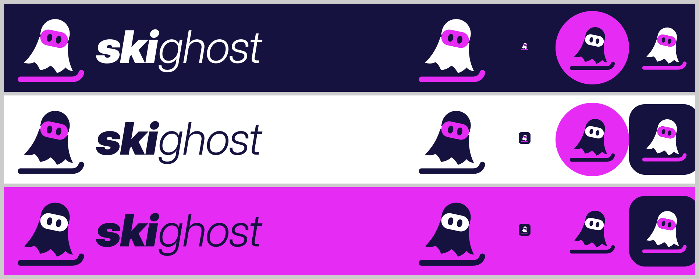

# skighost — identité visuelle

Le fantôme en drap glisse sur son ski, masque de ski sur les yeux. À côté, le mot **ski**ghost :
« ski » en Inter Display Black Italic, « ghost » en Inter Display Light Italic. L'italique et la
silhouette penchée donnent la vitesse.

## Couleurs

| Nom | HEX | Usage |
|---|---|---|
| Bleu nuit (ink) | `#16123F` | Fond principal, texte, fantôme sur fond clair |
| Fuchsia magenta | `#E62BF5` | Accent : masque, ski, boutons, liens |
| Blanc | `#FFFFFF` | Fantôme sur fond sombre |

Tokens prêts à l'emploi : [`tokens.css`](tokens.css) et [`tokens.json`](tokens.json).

## Fichiers

Tous les SVG ont un fond transparent (vraies découpes) ; chaque SVG a son PNG à côté.

| Dossier | Contenu |
|---|---|
| `logo/` | Logo horizontal (fantôme + skighost) : `on-dark`, `on-light`, `on-magenta` — PNG 2400 px |
| `symbol/` | Fantôme seul, mêmes trois versions — PNG 1024 px |
| `social/` | Avatars Instagram ronds (`ink`, `magenta`) — PNG 1080 px |
| `facebook/` | Photo de profil (1080 × 1080, carrée) et photo de couverture (1640 × 624) |
| `web/` | `favicon.ico`, `favicon.svg`, icônes PWA, `apple-touch-icon.png`, `site.webmanifest`, `head-snippet.html` |

Choisir la version selon le fond : `on-dark` sur bleu nuit ou photo sombre, `on-light` sur blanc
ou fond clair, `on-magenta` sur fond fuchsia.

## Règles d'usage

- Zone de protection : laisser autour du logo au moins la hauteur de la tête du fantôme.
- Taille minimale : logo horizontal 120 px de large ; fantôme seul 24 px (en dessous, utiliser le favicon).
- Ne pas déformer, recolorer hors palette, ajouter d'ombre ou de contour, ni redresser le fantôme.
- Ne pas poser le magenta sur le magenta : sur fond fuchsia, le masque passe en blanc.
- Police : Inter Display (licence SIL OFL, usage logo autorisé). Le mot-symbole est déjà vectorisé.
